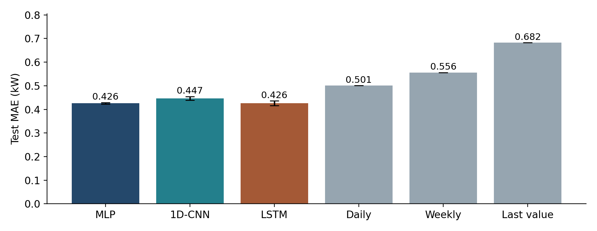

# Household Power Consumption Forecasting

**Elton Lewis (230953572) and Vignesh Rao (220953668)**
ICT 4442 Deep Learning Mini Project, Manipal Institute of Technology

We forecast the next 24 hourly active-power values from the previous 168 hours of household measurements. We compare an MLP, a 1D-CNN and a two-layer LSTM under one chronological evaluation protocol, alongside last-value, daily and weekly persistence baselines.

## Run on Kaggle

Open our [private Kaggle notebook](https://www.kaggle.com/code/eltonlewis/household-power-forecasting-final-comparison) with the owning account, or import `notebooks/02_final_kaggle.ipynb` into your own Kaggle account. Enable a GPU and Internet, then select **Save Version / Save & Run All**. The notebook contains the project source, downloads the UCI data, runs protocol tests, trains all three models for seeds 42, 43 and 44, and exports `forecast_results.zip`. No local model training is required.

The run uses Adam with learning rate 0.001, batch size 128, a maximum of 30 epochs and early stopping after six non-improving validation epochs. We restore each model's lowest-validation-MSE checkpoint before computing test metrics. The architectures remain those used for the interim submission.

To regenerate the embedded notebook after editing source code:

```powershell
python scripts/build_kaggle_notebook.py
```

## Evaluation protocol

- Dataset: [UCI Individual Household Electric Power Consumption](https://archive.ics.uci.edu/dataset/235/individual+household+electric+power+consumption), one household in Sceaux, France, December 2006 to November 2010.
- Aggregate observed minute readings into hourly means. Forward-fill missing input hours using past values only. Exclude any forecast window containing a target hour with fewer than 60 observed minute readings.
- Use seven measured variables, six cyclical calendar features and a weekend indicator. All 14 channels come from the historical input window.
- Split hourly rows chronologically into 70% training, 15% validation and 15% testing **before** constructing windows. Windows remain entirely inside their partition. Fit feature and target MinMax scalers on training rows only.
- Report MAE and RMSE in kW, MAPE in percent and pooled R-squared over all window/horizon pairs. MAPE uses a 0.0001 kW denominator floor and is sensitive to low-load hours.
- Report mean and sample standard deviation across three seeds. This variation measures optimization randomness, not uncertainty across households or time periods. Overlapping forecast windows are dependent.

The interim project already inspected this test period. These final experiments extend reproducibility on that same benchmark; they do not constitute a newly untouched holdout. We do not claim statistically significant superiority or generalization to other households.

## Verified final results

Kaggle version 2 completed all nine training runs and passed eight tests. All metrics below were independently recomputed from its saved predictions. Each run evaluates the same 4,621 test windows.

| Model | MAE (kW), mean +/- SD | RMSE (kW), mean | MAPE (%), mean | R-squared, mean |
| --- | ---: | ---: | ---: | ---: |
| MLP | 0.42556 +/- 0.00367 | 0.58369 | 59.41 | 0.32881 |
| 1D-CNN | 0.44663 +/- 0.00765 | 0.58951 | 68.95 | 0.31537 |
| LSTM | 0.42564 +/- 0.01003 | 0.58373 | 59.29 | 0.32872 |
| Daily persistence | 0.50105 +/- 0 | 0.75128 | 64.90 | -0.11194 |
| Weekly persistence | 0.55613 +/- 0 | 0.80168 | 76.94 | -0.26612 |
| Last-value persistence | 0.68223 +/- 0 | 0.93667 | 98.57 | -0.72842 |

MLP and LSTM are practically tied: their mean MAE differs by only 0.000082 kW, much less than the variability across seeds. MLP's mean MAE is 15.1% below daily persistence. In seed 42, LSTM has the lowest neural MAE; its peak-target MAE is 1.406 kW versus 0.375 kW outside peaks. The peak threshold is the training 90th percentile, 2.388 kW.



See [all runs](results/final/all_runs.csv), [mean and standard deviation](results/final/summary.csv), [peak error analysis](results/final/error_analysis.json), and [Kaggle provenance](results/final/kaggle_run.json). Full checkpoints, predictions and additional plots are available from the Kaggle notebook output. The final Word report and presentation are kept locally for course submission and are not part of this repository.

## Repository map

| Path | Purpose |
| --- | --- |
| `src/phase2.py` | Authoritative causal experiment, GPU/CPU support, baselines and artifact export |
| `src/models/` | MLP, CNN and LSTM definitions |
| `src/predict.py` | Reload a checkpoint and saved training scalers for a 24-hour forecast |
| `tests/` | Split, missing-label, gradient, metric and inference checks |
| `scripts/build_kaggle_notebook.py` | Package source into a standalone Kaggle notebook |
| `notebooks/02_final_kaggle.ipynb` | Final cloud experiment |
| `results/final/` | Compact final metrics, comparison plot and run provenance |
| `docs/literature.json` | Sources reviewed for the project report |

`src/train.py`, `src/data_loader.py` and `src/download_and_preprocess.py` remain because the final pipeline imports their model and download helpers. The final experiment reads the raw source and performs causal hourly preprocessing in `phase2.py`.

## Forecast from downloaded artifacts

Extract `forecast_results.zip` into `artifacts/`. With Python 3.11+ and `requirements.txt` installed:

```powershell
python src/predict.py --artifacts artifacts/seed_42 --model mlp --output artifacts/forecast.csv
```

For new data, pass `--csv path/to/hourly.csv`. The file must have a `datetime` column and the 14 features listed in `src/phase2.py`. Its last 168 rows must be finite and contiguous hourly observations. Outputs are hourly mean active power in kW, not daily energy totals. Forecasts are unconstrained point estimates and can be negative.

The notebook exports full run artifacts, including predictions, checkpoint files, dataset hashes, split manifests, learning curves and error plots.

## Team ownership and assistance

The synopsis assigns preprocessing, MLP and CNN to Vignesh Rao, and LSTM and common evaluation to Elton Lewis. Existing commits record those authors. The final integration commit uses Elton's author identity with Vignesh's co-author credit; prior history is retained.

We used OpenAI Codex assistance for the final code review, GPU execution setup, protocol tests, experiment orchestration, and documentation drafting. Both members must review their methodology and contribution statements and add their own signatures. Institutional plagiarism and AI-content reports remain actions for the team.
